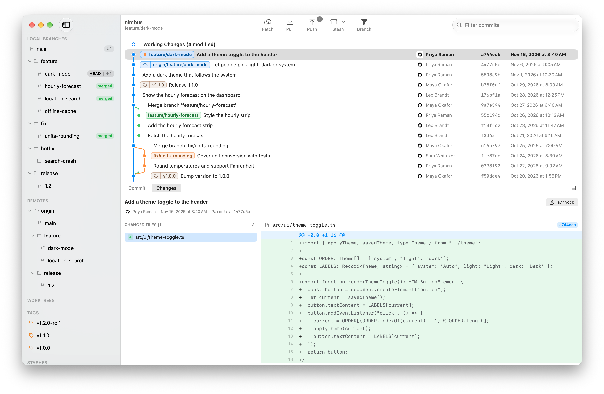

<div align="center">


# GitCraft

**A fast, lean, native Git client for macOS. Free and open source, with no subscription.**

[**Download for macOS**](https://github.com/goldspanlabs/gitcraft/releases/latest)
&nbsp;·&nbsp; [Features](#features) &nbsp;·&nbsp; [Benchmarks](#benchmarks) &nbsp;·&nbsp; [Install](#install) &nbsp;·&nbsp; [Build from source](#build-from-source)

[](https://github.com/goldspanlabs/gitcraft/releases/latest)
[](LICENSE)


<br>

<picture>
  <source media="(prefers-color-scheme: dark)" srcset="docs/screenshots/hero-graph-dark.png">
  
</picture>

</div>

## Why GitCraft?

- **Free, for good.** No trial, no license key, no subscription. GitCraft is MIT licensed.
- **Truly native, obsessively tuned.** Built with SwiftUI and AppKit on a Rust core and
  engineered for large repositories—instant to open, smooth to scroll, and light on memory even
  with tens of thousands of commits and multiple tabs open.
- **Uses your existing setup.** GitCraft works with your system `git` config and SSH keys.
  There's no account to create and nothing to sign in to.
- **Open source.** Read the code, file an issue, or send a pull request.

## Features

- **Undo & Redo for history actions:** Take back or redo resets, cherry-picks, reverts, and squashes (`⌘Z` / `⇧⌘Z`) with safety checks if the repository moved on.
- **First-class Git worktrees:** Create, lock, prune, and switch between linked worktrees with live dirty counts across sibling checkouts.
- **Markdown preview with rich diffs:** Toggle between raw diff and rendered Markdown in-place when inspecting `.md` files, with inline added/removed block highlights and relative image support.

## Benchmarks

GitCraft is engineered to stay fast and lightweight long after other Git clients bog down. Every
core path—repository loading, commit history, search, and syntax-highlighted diffs—is tuned for
low memory overhead and smooth scrolling on large, long-lived codebases.

On a **65,020-commit** repository (1,000 tracked files, 21 branches):

- **278 µs** to open the repository
- **2.71 ms** for the initial 500-row commit graph — 3× faster than `git log --all -n 500` (8.45 ms), and **438 µs** for cached pages
- **348 µs** to list 21 branches with ahead/behind counts
- **Scales effortlessly** across deep histories and multiple open tabs without memory spikes or slowdowns as you scroll

*Median release-build timings measured on macOS 27.2.1 (Apple M5, `git` 2.54.0, `rustc` 1.94.0).*

## Install

### Homebrew

```sh
brew install --cask goldspanlabs/tap/gitcraft
```

Update with `brew upgrade --cask gitcraft`. GitCraft isn't notarized by Apple, so the first time you
open it macOS will say it can't verify the app. Open **System Settings → Privacy & Security** and
click **Open Anyway**. You only need to do this once per install.

### Download

1. Download the latest `GitCraft-<version>.dmg` from
   [Releases](https://github.com/goldspanlabs/gitcraft/releases/latest).
2. Open the DMG and drag **GitCraft** to your **Applications** folder.
3. The first time you open it, macOS may say the app can't be verified. Open
   **System Settings → Privacy & Security** and click **Open Anyway**.

GitCraft needs macOS 15 Sequoia or later on an Apple Silicon Mac, and `git` 2.39 or later (installed
with the Xcode Command Line Tools: `xcode-select --install`).

## Build from source

The macOS build requires SwiftPM, Rust, and `codesign`:

```sh
make
```

This produces `build/GitCraft.app`. The Rust core can be tested independently with:

```sh
cargo test --manifest-path rust-core/Cargo.toml
```

See [AGENTS.md](AGENTS.md) for the project layout and the full list of build and test commands.

## Contributing

Bug reports, feature ideas and pull requests are welcome. Please
[open an issue](https://github.com/goldspanlabs/gitcraft/issues) to discuss bigger changes first.

## License

GitCraft is released under the [MIT License](LICENSE).
